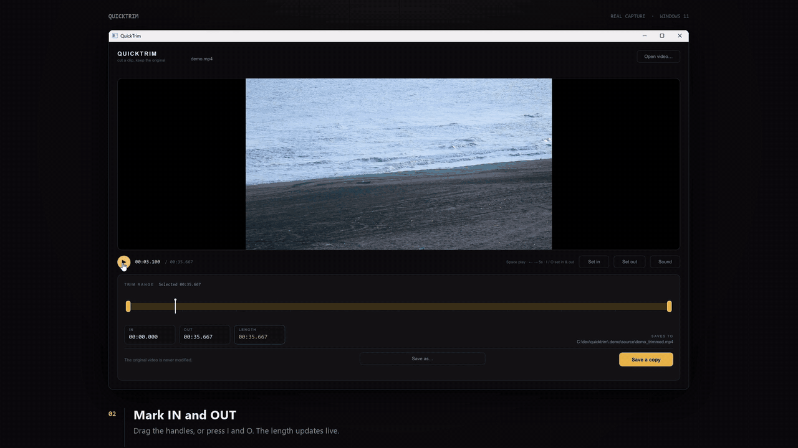
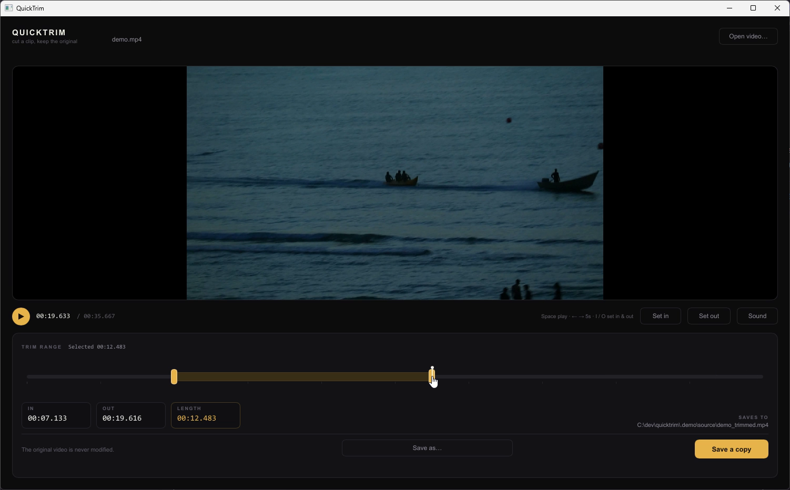

<p align="center">
  
</p>

<h1 align="center">QuickTrim</h1>

<p align="center">
  <strong>Open a video. Pick a start and an end. Save a copy.</strong><br>
  A small desktop utility that does exactly one job — and never touches the original.
</p>

<p align="center">
  <a href="https://github.com/quicktrim/quicktrim/actions/workflows/ci.yml"></a>
  <a href="https://github.com/quicktrim/quicktrim/releases"></a>
  <a href="LICENSE"></a>
  
  
</p>

<p align="center">
  
</p>

<p align="center">
  <a href="docs/media/demo.mp4"><strong>▶ Watch the full demo</strong></a> (26 s, 1080p, 3.3 MB) ·
  real capture of the app on Windows 11
</p>

---

QuickTrim is not an editor. There is no timeline of layers, no effects, no
project file, no account, no network access and no telemetry. You open a video,
drag two handles, and save a new file. The original is opened read-only and is
never written to.

```
Open video  →  drag IN and OUT  →  Save a copy
```

## Download

**[Latest release →](https://github.com/quicktrim/quicktrim/releases/latest)**

| | |
| --- | --- |
| Windows 11, 64-bit | `quicktrim-<version>-win-x64.zip` — portable folder, no installer, no registry writes |
| Size | ~325 MiB / 341 MB (the app is 8.7 MB; FFmpeg and libmpv are bundled and unmodified) |
| Verifying | every release ships `SHA256SUMS.txt` and a `.zip.sha256` |
| Uninstall | delete the folder |

Extract it anywhere and run `quicktrim.exe`. You can pass a file path, or drag a
video onto the window. Nothing is installed and nothing runs in the background.

> **Platform status:** Windows 11 x64 is the only platform that has been run,
> tested and verified. macOS and Linux are **not** claimed to work yet — see
> [Platform status](#platform-status). There is no macOS or Linux download.

## What it does

| | |
| --- | --- |
| **One window, one track** | Embedded libmpv preview, a single track, two draggable handles, a playhead. |
| **Frame-accurate cuts** | A stream copy when both cuts land on keyframes; `libx264 -crf 20` otherwise. Results are verified before they are published. |
| **Non-destructive by construction** | The input is opened read-only. Output goes to a hidden temporary sibling and is renamed into place only after it validates. |
| **Never overwrites** | The default name is `<stem>_trimmed.mp4`; collisions become `(2)`, `(3)`, and so on. |
| **Cancel is always safe** | Cancelling kills FFmpeg, reaps it, and deletes the partial file. Closing the window does the same. |
| **No surprises** | One actionable sentence for failures. Raw FFmpeg logs go to stderr, never to the interface. |
| **Keyboard first** | `Space`, the arrows, `I`/`O`, `Ctrl+S` and `Esc` cover the whole workflow; every button is labelled. |
| **Accessible labels** | Screen-reader labels on controls; audit still pending. |

## Keys

| Key | Action |
| --- | --- |
| `Space` | Play / pause |
| `←` / `→` | Skip 5 s (`Shift` for 1 s) |
| `Home` / `End` | Jump to the start / end |
| `I` / `O` | Set IN / OUT at the playhead |
| `Ctrl+S` | Save a copy |
| `M` | Mute |
| `Esc` | Cancel a running export, otherwise dismiss the message |

<details>
<summary>Static screenshot</summary>
<br>

</details>

## Accuracy

QuickTrim never claims frame accuracy it cannot deliver. Two engines are used:

| Situation | Engine | Result |
| --- | --- | --- |
| Both cut points sit on keyframes (within 45 ms) **and** the codecs are safe in MP4 | stream copy | original encoded frames, typically under 0.1 s to export; a copy that drifts more than 200 ms is discarded and re-encoded |
| Anything else | `libx264 -preset veryfast -crf 20` + AAC 192 kbit/s | frame-accurate: FFmpeg seeks, decodes and discards up to the exact requested timestamp |

Every result is probed before it is published. If the duration is outside the
tolerance for the chosen mode, the copy is thrown away and retried as an encode.
Measured numbers — including the 0.15 s AAC priming that a stream copy can
carry — are in [`docs/measurements.md`](docs/measurements.md).

### The safety rules

* The input file is only ever opened for reading.
* Output is written to `.name.qt-part-<pid>-<nonce>` and renamed only after it validates.
* An existing file is never overwritten.
* Cancel kills the FFmpeg child, waits for it, and removes the partial file.
* Failures are one actionable sentence; logs stay on stderr.

## Build from source

| Tool | Version used | Notes |
| --- | --- | --- |
| Rust | 1.99.1 | `x86_64-pc-windows-gnu` (MSVC works too); `rust-version = 1.85` |
| C toolchain | GCC 15.2 (MinGW-w64) | only for the GNU Rust target |
| FFmpeg | 9.0.2 essentials build | `ffmpeg.exe`, `ffprobe.exe` |
| libmpv | v0.41.0-1205-g01e2533f3 | `libmpv-2.dll` |

```powershell
# Put the helpers next to the test and release binaries:
#   ffmpeg.exe, ffprobe.exe, libmpv-2.dll  →  target\debug\   (tests)
#                                          →  target\release\ (the app)
cargo test          # 54 tests: 39 unit + 15 real-media integration
cargo build --release
target\release\quicktrim.exe "C:\path\to\clip.mp4"
```

The binary also accepts no argument (empty window) and `--help` / `--version`.

At runtime the helpers are resolved in this order:

| Helper | Lookup |
| --- | --- |
| `ffmpeg` / `ffprobe` | `QUICKTRIM_FFMPEG` / `QUICKTRIM_FFPROBE` → directory of the executable → `PATH` |
| libmpv | `QUICKTRIM_LIBMPV` → executable directory (`libmpv-2.dll`, `libmpv.2.dylib`, `libmpv.so.2`) → system library names |

Bundling therefore means shipping the helpers beside the executable and
changing nothing else.

### Cutting a release

Releases are built by [`.github/workflows/release.yml`](.github/workflows/release.yml).
Pushing a version tag builds the app, fetches the pinned FFmpeg and libmpv
builds, assembles the portable folder and opens a draft release:

```bash
git tag -a v0.1.0 -m "QuickTrim 0.1.0"
git push origin v0.1.0
```

For a local build of the same artifact, see [`docs/releasing.md`](docs/releasing.md)
and [`scripts/package.ps1`](scripts/package.ps1).

## How it is put together

```
src/
  main.rs            entry point, CLI parsing
  app.rs             window state, channels, export flow, shutdown
  output.rs          naming, temp file, atomic finalize, reveal
  platform/          file dialog, dropped-path parsing, "show in folder"
  media/
    tools.rs         locating ffmpeg / ffprobe (env → exe dir → PATH)
    metadata.rs      ffprobe JSON → MediaInfo (duration, codecs, rotation)
    trim.rs          TrimRange, timecode formatting/parsing
    export.rs        copy-vs-encode plan, FFmpeg child, progress, validate
    playback.rs      libmpv via dynamic loading, render thread
    errors.rs        user-facing error types
ui/
  main-window.slint  the entire interface
tests/
  export_roundtrip.rs  real-media end-to-end tests
```

Three threading rules keep it predictable:

1. **The UI thread owns Slint.** Worker threads push into `mpsc` channels; a
   16 ms timer drains them and is the only place that mutates window properties.
2. **All libmpv calls happen on one dedicated thread.** Frames arrive as RGB
   buffers, are wrapped in a Slint `Image`, and are shown at up to 60 fps.
3. **FFmpeg is a child process, never a thread.** Cancelling is `kill()`, and
   the child is always reaped before the export future returns.

The media engine has no dependency on the GUI, which is why the export path is
covered by tests that run without a display.

Decisions and the reasoning behind them live in [`docs/adr/`](docs/adr/):
playback engine, export strategy, UI toolkit and renderer, packaging and
licensing.

## Platform status

| OS | Playback | Export | Claimed? |
| --- | --- | --- | --- |
| Windows 11 x86_64 | verified | verified | **yes** |
| Windows 10 | not tested | not tested | no |
| macOS (arm64/x86_64) | not tested | not tested | no |
| Linux (X11/Wayland) | not tested | not tested | no |

The code paths for the other platforms exist (dynamic library names, audio
output selection, `rfd` backends), but "exists" is not "works". Nothing is
marked supported until playback and export have both been run there.

## Known limitations

* **Always MP4 out.** A stream copy keeps the source video and audio codecs; a
  re-encode produces H.264/AAC. Subtitles, chapters, attachments and extra
  audio tracks are dropped.
* **Stream copy can be a hair long.** With AAC audio, a keyframe-aligned copy
  can carry about 0.2 s of priming. Cut on a non-keyframe when exactness
  matters more than speed.
* **HDR is not tone mapped.** HDR sources re-encode to SDR without a curve.
* **No frame-rate conversion.** Variable-frame-rate sources are cut at the
  requested time but their timing is not normalised.
* **Software renderer workaround.** The window repaints itself once a second
  (~2% of one core) to heal surfaces the OS throws away. See ADR 0003.
* **One file at a time.** Opening a second video replaces the first, and opening
  is blocked while an export runs.
* **Drag and drop is not covered by a test.** It uses Slint's `DropArea` and
  the OS drag source; only manual checks remain.
* **The bundle is ~325 MB.** Shrinking it is Phase 3. See ADR 0004.

## Roadmap

| Phase | Goal |
| --- | --- |
| 0 — done | Prove embedded playback + accurate export on one platform |
| 1 — next | Harden: drag/drop tests, save-as flows, error paths, signed releases |
| 2 | macOS and Linux bring-up, each with playback and export verified |
| 3 | Shrink the bundle (shared FFmpeg, trimmed libmpv), add an installer |

## Contributing

Issues and pull requests are welcome. Start with
[`CONTRIBUTING.md`](CONTRIBUTING.md); the useful rules are "keep it one job" and
"prove the claim with a test". Security reports: [`SECURITY.md`](SECURITY.md).

If you are looking for somewhere to start, the roadmap phases above and the
"not measured yet" list in [`docs/measurements.md`](docs/measurements.md) are
the honest backlog.

## Licence

QuickTrim is **GPL-3.0-or-later**. The shipped binary is conveyed as GPLv3
because Slint is used under its GPL-3.0-only option; FFmpeg's common builds are
GPL and mpv is GPLv2+. A permissively licensed build would require a commercial
Slint licence and an LGPL FFmpeg build.

See [`LICENSE`](LICENSE), [`THIRD_PARTY_NOTICES.md`](THIRD_PARTY_NOTICES.md) and
[ADR 0004](docs/adr/0004-packaging-and-licensing.md).

## Credits

* [Slint](https://slint.dev) — UI toolkit
* [libmpv / mpv](https://mpv.io) — playback
* [FFmpeg](https://ffmpeg.org) — probing and export
* Demo footage: ["Ocean surface waves"](https://commons.wikimedia.org/wiki/Category:Videos_of_ocean_surface_waves) (CC0, Wikimedia Commons). The app in the demo is the real Windows build; nothing is mocked.
